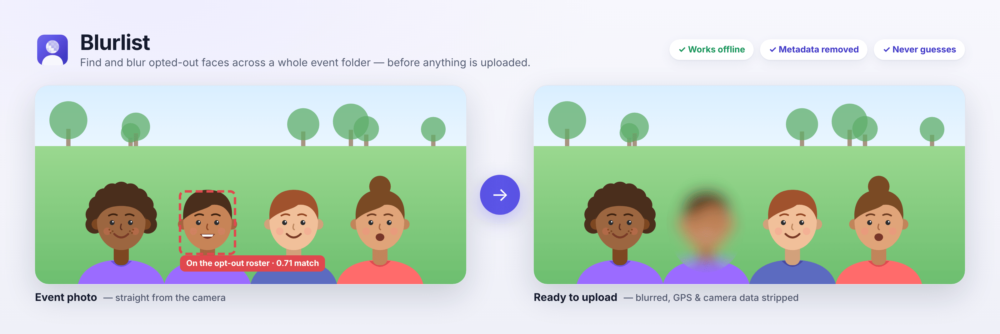
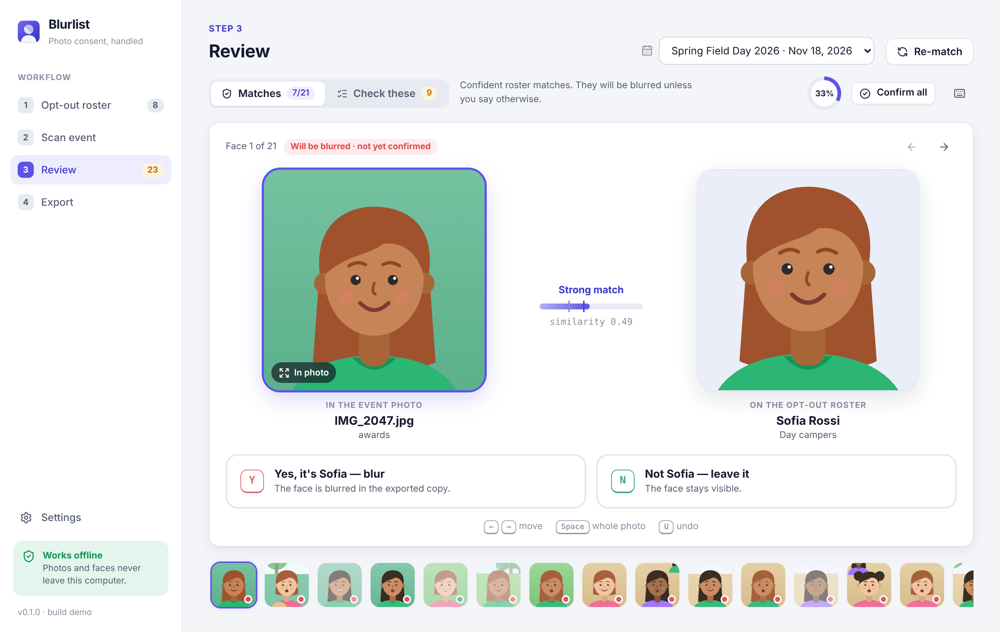
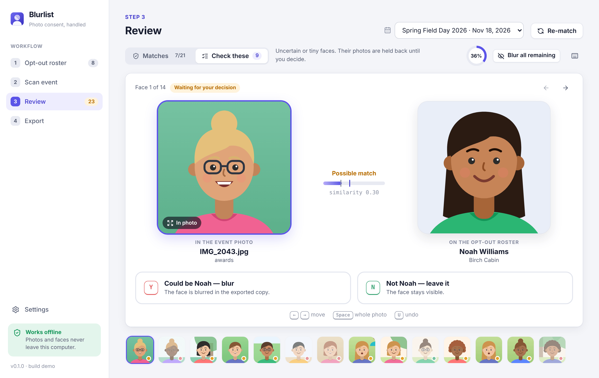
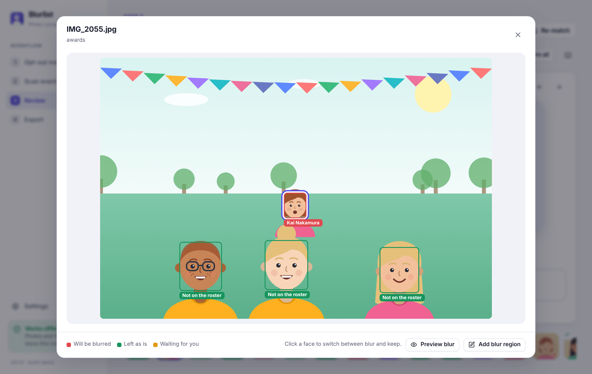
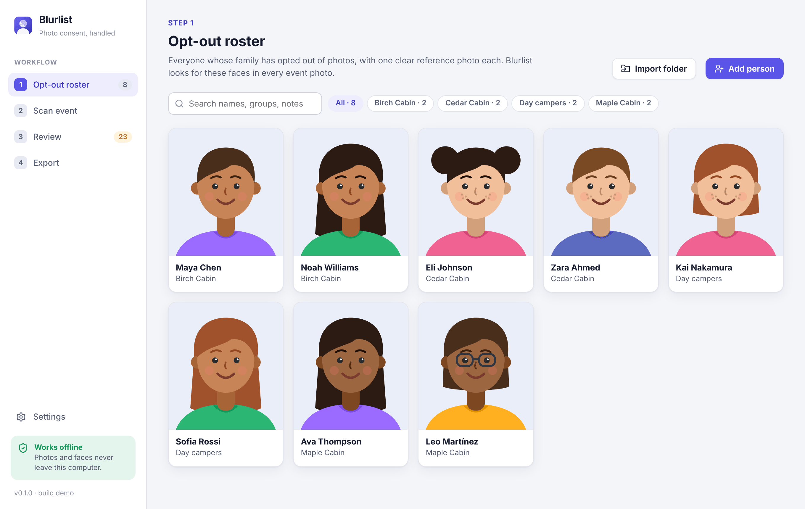
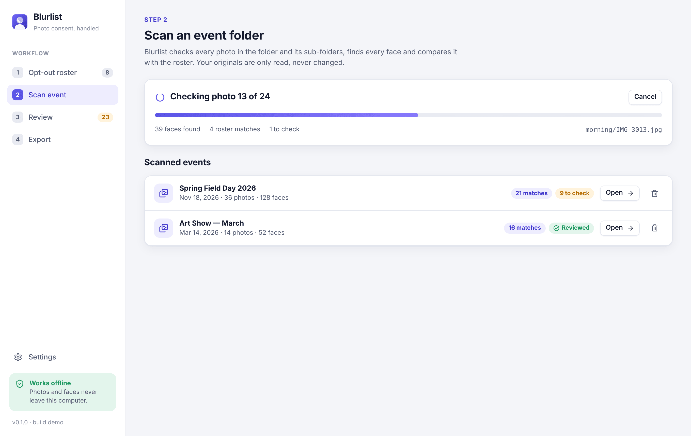
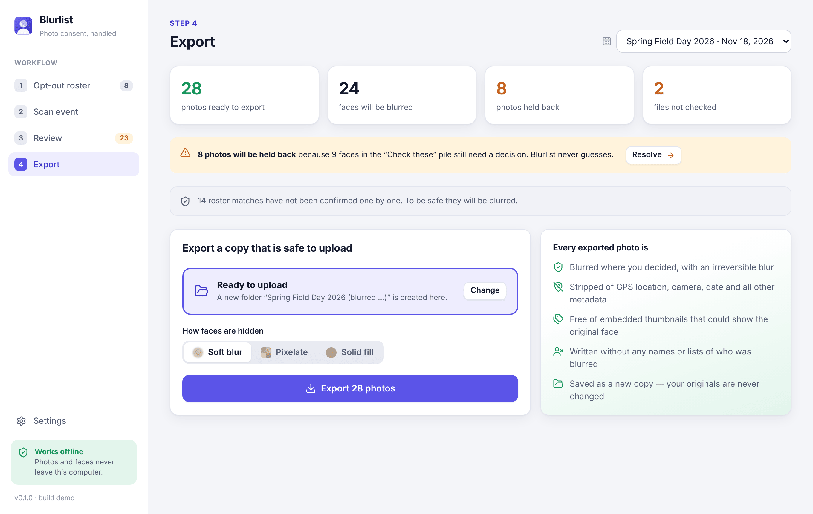
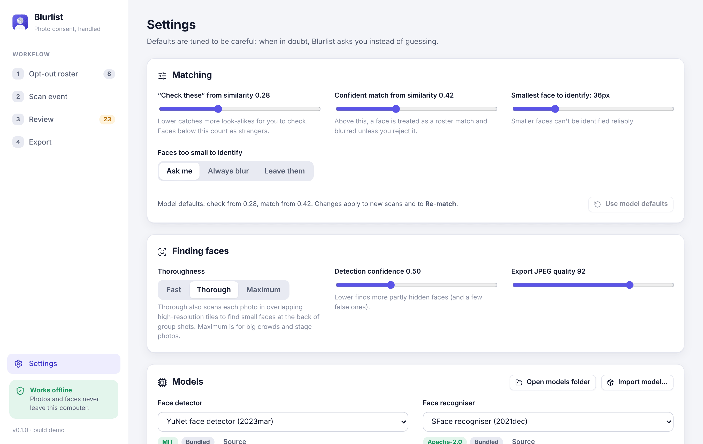
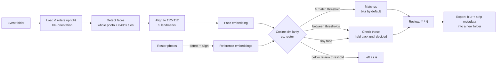

<p align="center">
  
</p>

<p align="center">
  <a href="https://github.com/lobojoel2003/Blurlist/actions/workflows/ci.yml"></a>
  <a href="https://github.com/lobojoel2003/Blurlist/releases/latest"></a>
  
  
  <a href="LICENSE"></a>
</p>

# Blurlist

**Blurlist finds and blurs the faces of opted-out children across a whole folder of event photos — on your
computer, before anything is uploaded.**

Schools, camps and youth nonprofits post event photos, but some families have opted out. Today a staff member
checks every photo by eye against a list, and one mistake puts a child's face online. With Blurlist the
organiser loads the opt-out roster with one reference photo each, points it at the event folder, confirms the
matches with one key each, and exports a copy that is safe to share.

- 🔒 **Nothing leaves the machine.** No accounts, no cloud, no telemetry — Blurlist contains no network code.
- 🙋 **It never guesses.** Uncertain matches go to a *Check these* pile. Photos with an undecided face are held
  back from export instead of being blurred or skipped silently.
- ⌨️ **Fast to review.** Every match is shown side by side with the roster photo: `Y` blur, `N` leave.
- 🧽 **Safe output.** Irreversible blur, and every exported file is stripped of GPS, camera data, dates and
  embedded thumbnails.

**[⬇ Download the latest release](https://github.com/lobojoel2003/Blurlist/releases/latest)** for Windows,
macOS or Linux.

---

## Contents

- [Why Blurlist](#why-blurlist)
- [Tour](#tour)
- [Install](#install)
- [How to use it](#how-to-use-it)
- [How it works](#how-it-works)
- [Models and licensing](#models-and-licensing)
- [Privacy and safety](#privacy-and-safety)
- [Limitations](#limitations)
- [Command-line tool](#command-line-tool)
- [Build from source](#build-from-source)
- [Versioning, builds and releases](#versioning-builds-and-releases)
- [Contributing](#contributing) · [License](#license)

## Why Blurlist

**The need is real.** U.S. public schools and districts have shared about 20 million student photos online;
students are identifiable in about 4.9 million of them, and 726,000 also carry full names and approximate
locations ([THE Journal](https://thejournal.com/articles/2024/03/04/media-management-for-schools-enters-us-market-addresses-student-privacy-concerns.aspx)).
Schools already pay to solve it: Pixevety is used in more than 300 schools in eight countries
([GovTech](https://www.govtech.com/education/k-12/australian-companys-k-12-consent-tool-arrives-in-u-s)), and
BlurMe reports more than 600 U.S. school districts using its redaction tool
([press release](https://natlawreview.com/press-releases/blurme-surpasses-600-us-school-districts-using-its-ai-video-redaction)).

**What exists falls short** for a small school, camp or nonprofit:

| Tool | Finds opted-out faces automatically | Children's photos stay on your computer | Free |
| --- | :---: | :---: | :---: |
| [Pixevety](https://pixevety.com) | ✅ | ❌ cloud service | ❌ |
| [Vidigami](https://vidigami.com/2025/03/28/how-does-ai-impact-the-way-schools-manage-student-photos/) | ✅ | ❌ cloud service | ❌ |
| BlurMe | ✅ | ❌ cloud service | ❌ |
| [Face Privacy](https://outilstice.com/en/face-privacy-outil-pour-flouter-photos-ecole/) | ❌ blur each face by hand | ✅ | ✅ |
| **Blurlist** | ✅ | ✅ | ✅ open source |

## Tour

### Review: every match side by side with the roster photo

One key to accept (`Y`) or reject (`N`). Arrow keys move, `Space` opens the whole photo, `U` undoes. The
filmstrip shows what is left at a glance, and the similarity meter shows where the score sits between the
*check* and *match* thresholds.



### "Check these": uncertain faces wait for a person

Look-alikes and faces too small to identify are never decided automatically. Until someone answers, their
photos are held back from export.



### The whole photo, with every face outlined

Click a face to switch between blur and keep, preview the blur, or drag a box over anything the detector
missed — a face in profile, a name badge, a reflection.



<table>
  <tr>
    <td width="50%"><b>Opt-out roster</b> — one clear photo per person, grouped by class, cabin or team.
      Import a whole folder at once.<br><br></td>
    <td width="50%"><b>Scan</b> — every photo in the folder and its sub-folders, with live progress.
      <br><br></td>
  </tr>
  <tr>
    <td width="50%"><b>Export</b> — a new, metadata-free copy; held-back photos are listed, never silently
      dropped.<br><br></td>
    <td width="50%"><b>Settings</b> — careful defaults, adjustable thresholds and models, all explained.
      <br><br></td>
  </tr>
</table>

<sub>All screenshots use the built-in demo with illustrated people. No real children appear anywhere in this
repository.</sub>

## Install

Download the file for your system from the
**[latest release](https://github.com/lobojoel2003/Blurlist/releases/latest)**. The face models are included;
no internet connection is needed after installing.

| System | File | Notes |
| --- | --- | --- |
| Windows 10/11 (x64) | `Blurlist_<version>_x64-setup.exe` (or `.msi`) | If SmartScreen says *Windows protected your PC*, choose **More info → Run anyway**. |
| macOS 13.4+ (Apple Silicon) | `Blurlist_<version>_aarch64.dmg` | Drag to Applications. On first launch right-click → **Open**. If macOS says the app is damaged, run `xattr -cr /Applications/Blurlist.app` once. |
| Linux x64 | `.AppImage`, `.deb` or `.rpm` | AppImage: `chmod +x Blurlist_*.AppImage && ./Blurlist_*.AppImage`. Needs glibc 2.39+ and WebKitGTK 4.1: Ubuntu 24.04+, Debian 13+, Fedora 40+ or similar. |

Intel Macs are not supported yet: the ONNX Runtime build that Blurlist links no longer ships for Intel macOS.

The warnings appear because these builds are not signed with a paid developer certificate; the release
workflow signs automatically once certificates are added as repository secrets. Every release lists SHA-256
checksums in `SHA256SUMS.txt`:

```bash
sha256sum -c SHA256SUMS.txt --ignore-missing
```

## How to use it

1. **Build the opt-out roster.** *Add person* for one child at a time, or *Import folder* for many. A folder
   import treats each file as one person, named after the file, with sub-folders as groups:

   ```text
   Opt-out roster/
   ├── Maple Cabin/
   │   ├── Ava Thompson.jpg
   │   └── Leo Martinez.jpg
   └── Birch Cabin/
       ├── Maya Chen.jpg
       └── Maya Chen (2).jpg   ← a second photo of the same child
   ```

   Use a recent, clear, front-facing photo. Blurlist warns you when a face is small or turned, asks you to pick
   the right face when a photo shows several people, and lists any file it could not add.
2. **Scan the event folder.** Choose the folder you copied from the camera or phone. Originals are only read.
3. **Review.** Confirm each match with `Y` or reject it with `N`, then clear the *Check these* pile.
4. **Export.** Pick a destination outside the event folder. Blurlist writes a new folder named
   `<event> (blurred <date>)` that is ready to upload.

Added someone to the roster after scanning? Open the event in *Review* and click **Re-match** — it reuses the
stored face fingerprints, takes seconds and keeps your earlier decisions where nothing changed.

### Keyboard shortcuts

| Key | Action |
| --- | --- |
| `Y` (or `B`) | Blur this face — accept the match |
| `N` (or `K`) | Leave this face — reject the match |
| `→` / `←` | Next / previous face |
| `Space` | Show the whole photo |
| `U` or `Ctrl/⌘ + Z` | Undo the last decision |
| `?` | Show all shortcuts |

## How it works



- **Detection.** Faces are found with YuNet on the whole photo *and* on overlapping 640×640 tiles of a 1920 px
  (or 3200 px in *Maximum* mode) copy, then merged with non-maximum suppression. Event photos are often
  20+ megapixels with small faces at the back of a group; the tiled pass finds faces a single downscaled pass
  misses (the test suite checks a 42 px face in a 12 MP photo).
- **Recognition.** Each face is aligned to the standard five-point ArcFace template with a least-squares
  similarity transform and embedded with SFace (128-d). The implementation is verified against OpenCV's
  reference `FaceDetectorYN` / `FaceRecognizerSF` in the tests.
- **Decision.** The best cosine similarity to each roster person (over all their photos) is compared with two
  thresholds. For SFace the defaults are 0.42 (*match*) and 0.28 (*check*); OpenCV's published same-person
  threshold is 0.363. Faces smaller than 36 px are never auto-matched.
- **Blur.** The face region (enlarged 1.6× wide and 1.75× tall to cover hair, ears and chin) is averaged down to
  about seven colour cells across the face — which destroys identity — then smoothed and feathered into the
  photo with an elliptical mask. The detected box always lies inside the fully blurred core.
- **Export.** Photos are re-encoded from upright pixels, so no EXIF/GPS/XMP/IPTC block, maker note or embedded
  thumbnail survives. The ICC colour profile is kept so colours don't shift.

The engine lives in [`crates/blurlist-core`](crates/blurlist-core) (Rust, ONNX Runtime via
[`ort`](https://github.com/pykeio/ort), SQLite via `rusqlite`, the `image` crate for decoding, blurring and
encoding). The desktop app is a [Tauri 2](https://tauri.app) shell in [`src-tauri`](src-tauri) with a React UI
in [`src`](src).

## Models and licensing

Many face-recognition weights are licensed for research only, which would rule them out for a school or camp
using Blurlist in production. Blurlist therefore **bundles only permissively licensed models**:

| Model | Role | Licence | Bundled |
| --- | --- | --- | :---: |
| [YuNet 2023mar](https://github.com/opencv/opencv_zoo/tree/main/models/face_detection_yunet) (OpenCV Zoo) | Face detector, 5 landmarks | [MIT](models/licenses/YuNet-MIT.txt) | ✅ |
| [SFace 2021dec](https://github.com/opencv/opencv_zoo/tree/main/models/face_recognition_sface) (OpenCV Zoo) | Recogniser — margin-based, ArcFace-class, 99.4% on LFW | [Apache-2.0](models/licenses/SFace-Apache-2.0.txt) | ✅ |
| SCRFD (`det_10g`, `det_500m`) — [InsightFace](https://github.com/deepinsight/insightface) | Face detector | Non-commercial research only | ❌ supported |
| ArcFace (`w600k_r50`, `w600k_mbf`) — InsightFace | Recogniser, 512-d | Non-commercial research only | ❌ supported |

SCRFD and ArcFace decoders are fully implemented and tested. If you are entitled to use those weights, drop the
files into the models folder (*Settings → Models → Open models folder*) and select them. Any other ONNX model
with one of the four layouts can be imported from *Settings → Models → Import model…* — always check the model
card's licence first. See [`models/README.md`](models/README.md).

## Privacy and safety

- **Offline by design.** The app has no network code, no update checks and no analytics. Its content security
  policy blocks all outgoing connections from the interface.
- **Originals are never modified.** Exports go to a new folder, and Blurlist refuses to export into the event
  folder itself.
- **Fail-safe defaults.** Unconfirmed matches are blurred; undecided faces hold their photo back; photos that
  changed on disk after scanning are held back; unsupported files (HEIC, RAW, video) are listed as *not checked*
  and never copied.
- **No names in the output.** Nothing identifying is written into the export folder.
- **Local data.** The roster, face crops and decisions live in a SQLite database in the app's data folder (shown
  in *Settings → About*). Removing an event deletes its face crops.

More detail in [PRIVACY.md](PRIVACY.md).

## Limitations

Blurlist is an aid for a careful person, not a guarantee. In particular:

- Faces in strong profile, heavily occluded (masks, face paint, hands) or very small may not be detected. Use
  the photo viewer's *Add blur region* for anything missed, and keep *Thoroughness* at *Thorough* or *Maximum*
  for crowd shots.
- Children change quickly. Use recent reference photos and add a second photo when matching is weak.
- HEIC/HEIF, RAW and video files are not processed yet (they are reported, never exported). Export HEIC photos
  as JPEG from your phone or Photos app first.
- Transparency in PNG/WebP files is flattened onto white on export.

## Command-line tool

Each release includes `blurlist-cli_<version>_<platform>` with the same engine and database format:

```bash
blurlist roster import "Opt-out roster"          # folder of Name.jpg files
blurlist scan "Spring Field Day"                 # prints matches and the check pile
blurlist review 1 --pile check                   # list faces that need a decision
blurlist decide 42 blur                          # or keep
blurlist export 1 ~/Desktop/ready-to-upload
blurlist --help
```

## Build from source

Requirements: [Rust](https://rustup.rs) (stable), [Node.js](https://nodejs.org) 22+, and on Linux the
[Tauri system dependencies](https://v2.tauri.app/start/prerequisites/)
(`libwebkit2gtk-4.1-dev libayatana-appindicator3-dev librsvg2-dev patchelf`).

```bash
git clone https://github.com/lobojoel2003/Blurlist.git
cd Blurlist
npm ci
npm run fetch-models          # downloads YuNet + SFace and verifies their SHA-256
npm run tauri dev             # run the desktop app
npm run tauri build           # build installers into target/release/bundle
```

ONNX Runtime is linked statically by default (`ort`'s prebuilt binaries are downloaded at build time). To use a
system ONNX Runtime instead, build with `--no-default-features --features load-dynamic` and set
`ORT_DYLIB_PATH` to `libonnxruntime`.

`npm run dev` opens the interface in a normal browser with an illustrated demo backend — handy for UI work.

### Tests

```bash
npm run lint && npm run typecheck && npm test                       # UI: unit and component tests
cargo fmt --all --check
cargo clippy --workspace --all-targets --features blurlist-core/cli -- -D warnings
BLURLIST_REQUIRE_MODELS=1 cargo test -p blurlist-core --features cli  # engine, with the real models
```

The engine tests run the real models on public-domain fixtures and compare detections and similarities with
OpenCV's reference implementation; check EXIF-rotated input, tiled detection, the *Check these* hold-back,
re-matching, metadata stripping and that originals are never touched.

### Project layout

```text
crates/blurlist-core/   Rust engine: detection, alignment, embeddings, matching, blur, export, SQLite store, CLI
src-tauri/              Tauri desktop shell: commands, media:// protocol, packaging config
src/                    React + TypeScript UI (and the illustrated demo backend)
models/                 Model manifest, licences (weights are downloaded, not committed)
scripts/                fetch-models, version management, README screenshots
.github/workflows/      CI, cross-platform installer builds, releases
```

## Versioning, builds and releases

- **Semantic versioning.** One version for everything, kept in `package.json`, the Cargo workspace and the
  lockfiles (`tauri.conf.json` reads it from `package.json`). `node scripts/version.mjs check` verifies they
  agree; CI runs it on every push.
- **Build numbers.** CI stamps every binary with the GitHub Actions run number, commit and build date — shown in
  *Settings → About* and `blurlist --version`, e.g. `0.1.0 (build 42, 1a2b3c4)`. Local builds say `build dev`.
- **Continuous integration** ([`ci.yml`](.github/workflows/ci.yml)): formatting, linting, type checks and UI
  tests; the engine's tests with real models on Linux, macOS and Windows; and, on `main`, installers for every
  platform uploaded as build artifacts.
- **Releases** ([`release.yml`](.github/workflows/release.yml)): pushing a tag `vX.Y.Z` checks that the tag
  matches the version, takes the notes from [CHANGELOG.md](CHANGELOG.md), builds Windows, macOS (Apple Silicon)
  and Linux installers plus the CLI, attaches `SHA256SUMS.txt` and publishes the GitHub Release.

To cut a release:

```bash
node scripts/version.mjs set 0.2.0      # bump every manifest
# add a "## [0.2.0]" section to CHANGELOG.md
git commit -am "Release 0.2.0"
git tag -a v0.2.0 -m "Blurlist 0.2.0"
git push origin main v0.2.0
```

## Contributing

Bug reports and pull requests are welcome — see [CONTRIBUTING.md](CONTRIBUTING.md). Please **never attach real
photos of children** to issues or pull requests. Report security or privacy problems privately as described in
[SECURITY.md](SECURITY.md).

## License

Blurlist is free software under the [GNU General Public License v3.0 or later](LICENSE). The bundled models keep
their own licences: YuNet ([MIT](models/licenses/YuNet-MIT.txt)) and SFace
([Apache-2.0](models/licenses/SFace-Apache-2.0.txt)). Test fixtures are U.S. government works in the public
domain ([details](crates/blurlist-core/tests/fixtures/README.md)).
